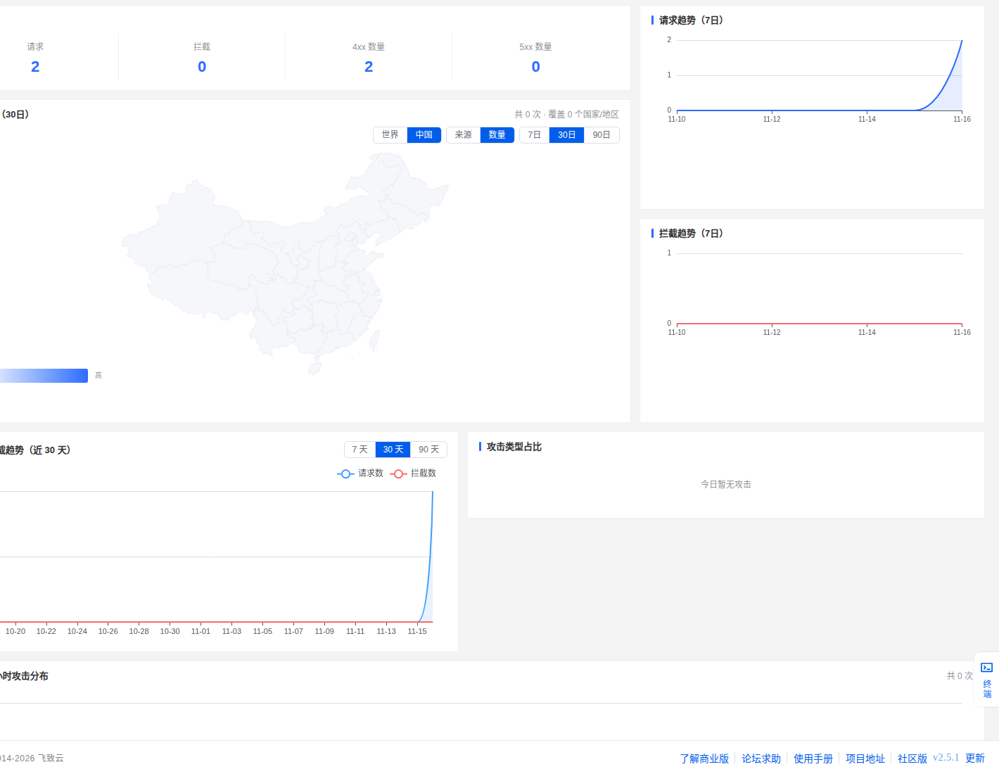
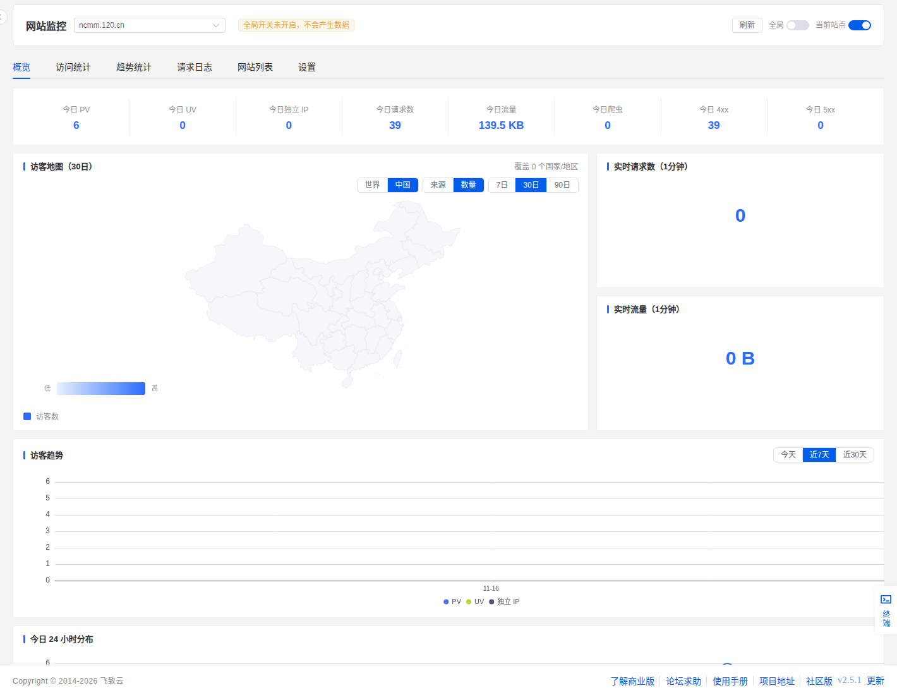

# 1Panel Mod

> 给 **1Panel v2.5.1 社区版** 补上官方付费版才有的 WAF / 网站监控功能。
> 本项目是**非官方补丁**，不属于 1Panel 官方发行版，与 1Panel 团队无关。

补丁只以「新增文件 + 覆盖少量前端文件」的方式工作，不改动 1Panel 的业务逻辑；
产物是重新编译的 `1panel-core` 与 `1panel-agent` 两个二进制，安装脚本负责备份、替换、菜单注入与回滚。

---

## 功能

| 模块 | 内容 |
|---|---|
| **WAF 概览** | 今日状态（请求 / 拦截 / 4xx / 5xx）、拦截地图（世界 / 中国、来源 / 数量、7/30/90 日）、请求与拦截趋势、攻击类型占比、24 小时分布、攻击来源 IP / URL / 规则 / 归属地 TOP |
| **拦截日志** | 多实例日志聚合、按站点/IP/URL/规则筛选、导出与清空 |
| **封锁记录** | 封锁列表、手动加解封、导出 |
| **黑白名单** | IP / URL 名单、批量导入 |
| **网站设置** | 站点级防护配置、CDN 真实 IP 策略、独立自定义规则 |
| **自定义规则** | 官方同款表单：匹配对象 / 条件 / 内容 / 动作 / 状态码，实时正则预览，全局与站点两级规则库 |
| **全局设置** | 各防护模块开关、CC / 攻击计数、日志保留策略、文件上传限制 |
| **网站监控** | 独立一级菜单，6 个页签：概览（8 指标 + 访客地图 + 实时请求/流量 + 访客趋势）、访问统计、趋势统计、请求日志（筛选 + 分页）、网站列表、设置 |
| **地区访问限制** | 国家 / 中国省份 / **中国城市**三级，留空即不限制，支持「拦截所选」与「仅允许所选」 |
| **IP 库管理** | GeoIP / BlackIP / SpiderIP 状态与哈希、镜像内置库提取、自定义地址下载、MaxMind 嵌套结构自动转换成 1pwaf 扁平结构、**可选 GitHub 加速源 / 自定义镜像** |
| **更新检测** | 官方社区版更新保持原样（升级前会警告会覆盖补丁）；Mod 版仅在点击时查本仓库 Release，只提示去仓库看更新命令 |

### 界面风格

蓝色竖条标题、无阴影白面板、2:1 栅格；中国地图为等比 choropleth，配水平「低 → 高」渐变条。




---

## 快速开始

**前提（两步走，本补丁不提供全新安装）**：

1. 先用官方脚本安装 1Panel v2.5.1 社区版：
   `bash -c "$(curl -sSL https://resource.1panel.pro/v2/quick_start.sh)"`
2. 到面板「应用商店」安装 **OpenResty**（WAF 数据与城市补丁都在它的挂载卷里）。
3. 以 root 执行下面的一键命令。

未检测到已安装的 1Panel 时，脚本会打印上面第 1 步命令后退出，不会擅自初始化面板。
端口、用户名、密码、安全入口全部沿用官方安装结果，本补丁**不生成也不修改**；
安装完成后会提示 `sudo 1pctl user-info` 查看登录信息。

```bash
curl -fsSL https://raw.githubusercontent.com/crossgg/1panel-mod/main/quick_start.sh | sudo bash
```

> 若仓库默认分支不是 `main`，把上面链接里的 `main` 换成实际分支名。

国内网络若拉不到 raw 文件，用加速前缀：

```bash
curl -fsSL https://v4.gh-proxy.org/https://raw.githubusercontent.com/crossgg/1panel-mod/main/quick_start.sh | sudo bash
```

仓库为私有时，改用带 token 的方式（或直接下载 Release 里的 `quick_start.sh`）：

```bash
curl -fsSL -H "Authorization: token $GITHUB_TOKEN" \
  https://raw.githubusercontent.com/crossgg/1panel-mod/main/quick_start.sh | sudo GITHUB_TOKEN="$GITHUB_TOKEN" bash -s --
```

脚本会自动：读 `1pctl version` 得到本机官方版本 → 查 `SUPPORTED.json` 选出对应的
Mod Release（索引不可用则按 `<官方版本>-mod.*` 前缀扫描 Releases）→ 检测系统架构 →
下载对应架构产物（本地包校验通过会跳过下载）
→ 校验 SHA256 → 解压到 `/opt/1panel-mod/releases/` → 调用随包附带的 `install.sh` 完成二进制替换、
菜单注入、日志默认值校正。失败会自动回滚。
**城市级地区限制 Lua 补丁默认不启用**（见下节）。

常用参数：

```bash
# 指定 Mod Release tag（不指定则按本机 1Panel 版本自动选）
curl -fsSL .../quick_start.sh | sudo bash -s -- --version v2.5.1-mod.1

# 安装时同时启用城市级地区限制补丁
curl -fsSL .../quick_start.sh | sudo bash -s -- --with-city

# 指定加速镜像（也可写完整模板，如 https://xxx/fetch?u={url}）
curl -fsSL .../quick_start.sh | sudo bash -s -- --mirror https://v4.gh-proxy.org/

# 仓库地址不同（例如 fork）或私有仓库
curl -fsSL .../quick_start.sh | sudo REPO=yourname/yourrepo GITHUB_TOKEN=ghp_xxx bash -s --

# 回滚 / 卸载
sudo bash /opt/1panel-mod/current/install.sh --rollback
sudo bash /opt/1panel-mod/current/install.sh --uninstall

# 跳过版本守卫（不推荐）
curl -fsSL .../quick_start.sh | sudo bash -s -- --force

# 事后单独补打城市补丁（OpenResty 装好后）
sudo bash /opt/1panel-mod/current/install.sh --city-only
```

### 手动安装

1. 在 [Releases](https://github.com/crossgg/1panel-mod/releases) 下载
   `1panel-waf-v2.5.1-linux-<amd64|arm64>.tar.gz` 与同名 `.SHA256SUMS`。
2. 解压并校验：`sha256sum -c SHA256SUMS`。
   > 不同 Mod 版本的产物文件名相同（都基于上游 `v2.5.1`），请从对应版本的 Release 页下载。
3. `sudo bash install.sh`。

`install.sh` 支持 `--rollback`、`--uninstall`、`--force`、`--no-lua`、`--no-menu`；所有写操作先备份到
`/opt/1panel-waf-backup/<时间戳>/`。

---

### 与官方安装脚本的关系

官方 `quick_start.sh` 其实只是**下载器**：取最新版本号 → 拼 `1panel-<v>-linux-<arch>.tar.gz`
→ 用 `checksums.txt` 校验 → 解压 → 执行包内 `install.sh`（真正的全新安装逻辑在这里：
装 systemd、初始化数据、生成随机端口/账号/密码/安全入口并打印登录信息）。

本仓库保持同样的两层结构，**但没有重新实现全新安装**：

| 层 | 官方 | 本仓库 |
|---|---|---|
| 下载器 | `quick_start.sh`（resource.1panel.pro） | `quick_start.sh`（GitHub Releases，含加速镜像回退） |
| 产物内安装器 | `install.sh`：全新安装 + 覆盖升级 | `install.sh`：**只做覆盖**（备份二进制、菜单注入、日志默认值、可选 Lua 补丁） |
| 版本守卫 | 无（装最新即可） | 只在 `install.sh` 做一次 v2.5.1 检查 |
| 登录信息 | 全新安装时打印 | 沿用官方结果，完成后提示 `1pctl user-info` |

两个脚本**不重复**：下载器负责找资产/校验/解压，安装器负责替换/回滚/卸载。

## 前置条件

| 项 | 要求 |
|---|---|
| 面板 | 1Panel **v2.5.1** 社区版（补丁针对该版本验证，其他版本会被安装脚本拒绝） |
| 系统 | Linux，`systemd`，x86_64 或 aarch64 |
| 权限 | root |
| 工具 | `curl`、`tar`、`sha256sum`、`python3`、`1pctl` |
| 容器 | 已安装官方 OpenResty 应用（WAF 数据与 Lua 补丁都在它的挂载卷里） |
| 全新安装 | 不支持，必须先跑官方 `quick_start.sh` |

---

## 版本、Tag 与上游升级

- **Tag 规则**：`v<官方版本>-mod.<序号>`，例如首个 Release `v2.5.1-mod.1`。
  tag 名本身编码了官方基线，`MOD_VERSION` 与 Release tag **永远是同一个值**（CI 的 `meta` job 统一计算）。
- **`SUPPORTED.json`**（仓库根，产物包内也有一份）是「官方版本 → Mod 版本 / 架构 / Go / Node」索引。
  `quick_start.sh`、`install.sh` 的守卫、面板「Mod 更新」三处都按它匹配本机版本；
  索引不可用时会按 tag 前缀回退扫描 Releases，所以忘了更新索引也不会装错，只少了明确的支持列表。
- **分支策略**：`main` 单主线跟随最新官方基线，旧基线用 tag 冻结（装对应 tag 的产物即可）。
  只有需要同时维护两个结构差异很大的官方版本时才开 `support/v2.5.x` 长期分支。
- 官方发新版时：clone 新 tag → `tools/check_upstream.sh <源码> <tag>` 看 BLOCK/WARN/OK →
  重新合并 3 个覆盖文件 → 更新 `SUPPORTED.json`、`patch/manifest.yaml`、CI 默认 `upstream_tag`、
  两个脚本的默认版本与文档 → 构建回归 → 打 `v2.5.2-mod.1`。完整 SOP 见 `AGENTS.md`。
- `check_upstream.sh` 只能做**自动体检 + 报告**；覆盖文件被官方重写时必须人工/AI 重新合并，
  因此不会自动出包，也没有任何定时轮询。

## 升级与更新检测

- **官方社区版**：面板「关于 → 更新」保持官方逻辑不变。官方升级会用官方二进制覆盖本补丁，
  因此升级抽屉里加了醒目警告；升级完成后必须重新运行 `install.sh`。
- **Mod 版**：「关于 → Mod 更新」并列显示。**只在点击「检查更新」时**才请求
  `https://api.github.com/repos/crossgg/1panel-mod/releases/latest`，页面加载时只读本地版本文件，
  没有任何定时轮询。Mod 版**不在面板内自动升级**，弹窗给出 Release 页链接与 `sudo bash install.sh` 提示。
- 当前 Mod 版本记录在 `/opt/1panel/1panel-mod/VERSION`（形如 `v2.5.1-mod.<n>`）。

---

## 城市级地区限制（使用前必读）

1pwaf 原生只按 `iso` 与 `province.en` 判定，`geoip.lookup()` 会丢掉 `city` 字段。本补丁的做法是：

- 把 `location_restrict.lua` 放在**宿主机挂载卷** `1pwaf/data/lua/`，并在同样位于挂载卷的
  `conf/waf.conf` 的 `lua_package_path` 最前面加一条路径，让 `require "location_restrict"` 优先命中补丁模块。
  **不需要重新构建容器 / 镜像 / docker commit，容器重建也不会丢。**
- 补丁模块用 `dofile` 加载官方字节码模块，原国家 / 省份 / 港澳台判定 100% 保留，只在其判定为「不拦截」后
  追加一次 `cityRules` 判定；城市值来自 `ngx.ctx.ip` 查询 mmdb 原始记录（含 CDN 修正）。
- **镜像自带的 GeoIP.mmdb 不含 city 字段**。要真正按城市拦截，请到「全局设置 → IP 库」下载
  P3TERX `GeoLite2-City.mmdb` 并勾选「自动转换 MaxMind 结构」。UI 在库不含城市时会禁用下拉并给出提示。
- 城市下拉存的是 `city.en`（如 `Guangzhou`），留空即不限制；转换完成后缓存按 mmdb 修改时间自动失效。
- 补丁会改 `conf/waf.conf` 的 `lua_package_path` 并 reload openresty，是唯一触碰 openresty 配置的动作，
  因此**默认不启用**：TTY 下会询问 `y/N`，`curl | bash`（无 TTY）默认跳过，显式 `--with-city` 才写。

### OpenResty 还没装怎么办

全新安装 1Panel 后 OpenResty 是应用商店里的**可选应用**，`1pwaf/data/` 尚不存在。
此时脚本不会写 Lua，而是打印提示：先到应用商店安装 OpenResty，再任选一种方式补打：

```bash
sudo bash /opt/1panel-mod/current/install.sh --city-only
```

或到「全局设置 → 地区访问限制」点「应用城市补丁」。该页面有**三步就绪状态卡**：
① OpenResty 是否就绪 → ② Lua 补丁是否已应用 → ③ GeoIP 是否含城市库。
按钮与「是否已选城市」解耦，所以即使还没有 City 库也能先打补丁。
`GET /geo/city/status` 会返回 `openresty_ready`，未就绪时给出中文指引。

若 1Panel 应用升级重写了 `waf.conf`，重新运行 `--city-only` 或在地区策略页点「应用城市补丁」即可。

---

## IP 库与加速源

- 默认**直连优先、失败自动回退**内置镜像（顺序按实测连通性：`v4.gh-proxy.org` → `gh-proxy.com` →
  `ghfast.top` → `ghproxy.net`）。
- 下载弹窗可勾选「使用加速源」，选择预设或填写自定义镜像（支持前缀式 `https://xxx/` 和
  模板式 `https://xxx/fetch?u={url}`）。
- 下载链路带**停滞看门狗**：某个候选 25 秒没有新字节就取消并换下一个，避免直连拿到响应头后
  body 挂死导致一直等到 30 分钟超时。
- `GeoLite2-City.mmdb`（MaxMind 嵌套结构）会自动转换成 1pwaf 要求的扁平结构，含
  country / province / city / iso / latitude / longitude；转换是后台任务，进度实时显示。

---

## 自己构建

### GitHub Actions（推荐）

`.github/workflows/build.yml`，`workflow_dispatch` 手动触发或推 `waf-v*` tag 触发，**不设任何定时任务**：

```
checkout 官方 1Panel v2.5.1 → patch/apply.sh → npm ci → npm run build:pro
→ CGO_ENABLED=0 交叉编译 agent/core（amd64 + arm64）→ 打包 + SHA256 → 发布 Release
```

可填 `upstream_tag`（默认 `v2.5.1`）、`mod_version`（留空自动生成 `v2.5.1-mod.<run_number>`）、
`create_release`。Release 会附带 `patch-source.tar.gz` 作为对应源码。

### 本地构建

```bash
git clone --depth 1 --branch v2.5.1 https://github.com/1Panel-dev/1Panel.git 1panel-src
bash patch/apply.sh ./1panel-src
cd 1panel-src/frontend && npm ci && npm run build:pro
# 然后分别编译 agent 与 core（见 tools/dev/build.sh）
```

环境：Go 1.27.3、Node 22、`CGO_ENABLED=0`。前端资源会 embed 进 `1panel-core`，所以**必须重新构建 core**。

---

## 仓库结构

```
.github/workflows/build.yml   CI：patch → 构建 → 发 Release
.gitignore                    排除本地工作区 / 临时产物 / archive
AGENTS.md                     ★ AI 速读指南（上游升级决策树 + 硬坑清单）
README.md                     人读文档
SUPPORTED.json                ★ 官方版本 → Mod 版本 / 架构 索引
quick_start.sh                下载器：按本机版本选 Release → 校验 → 解压 → 调 install.sh
install.sh                    产物内安装器：备份 / 替换 / 菜单 / 回滚 / 可选城市补丁
docs/                         界面截图
patch/                        ★ 补丁本体（与官方源码树同构）
  apply.sh                    幂等应用 / --remove 还原
  manifest.yaml               ★ 机器可读清单（kind / depends_on / check / risk）
  agent/ core/ frontend/ lua/
  scripts/                    HideMenu 注入、路由追加脚本
tools/
  check_upstream.sh           ★ 上游发新版时先跑它，输出 BLOCK/WARN/OK 三档
  dev/                        调试 / 验证 / 构建脚本（不参与发布产物）
archive/                      历史遗留文件（已 .gitignore，不入库）
```

上游升级 SOP 见 `AGENTS.md`：先 `tools/check_upstream.sh <官方源码目录>`，
按 `patch/manifest.yaml` 处理覆盖文件与依赖符号，再重建 + 回归。

---

## 常见问题

**Q：安装后侧边栏没有 WAF / 网站监控？**
A：菜单节点写在 `core.db` 的 `settings.HideMenu` 里，安装脚本会注入。若仍不显示，重启 `1panel-core`
或重新运行 `install.sh`（不要加 `--no-menu`）。

**Q：刷新 WAF 页面出现「Access Temporarily Unavailable」？**
A：`core/constant/common_waf_patch.go` 负责把 `/waf-log/*`、`/waf-monitor/*` 加进前端路由白名单，
确认该文件已随补丁编译进 core。

**Q：网站监控没有数据？**
A：监控采集需要**全局开关与站点开关同时为 on**。页面顶部有两个开关，任一关闭都会给出提示。
另外监控开关写入后需要 reload（脚本与接口都会自动执行）。

**Q：日志保留天数 / 单库上限真的会自动清理吗？**
A：镜像自带的 `global.json` / `monitor.json` 里这两个字段在社区版源码中没有对应的清理执行体，
补丁只把默认值校正为 WAF 500MB / 监控 100MB 并在 UI 中说明，不额外加定时清理任务。

**Q：官方升级了 1Panel 怎么办？**
A：官方二进制会覆盖补丁。请下载与本仓库对应新官方版本的产物（或重新构建），再运行 `install.sh`。
安装脚本有版本守卫，版本不匹配会拒绝安装。

**Q：这是破解 / 绕过授权吗？**
A：不是。项目只是基于 1Panel 开源代码（GPL-3.0）重新编译并新增自有功能，不触碰任何授权校验逻辑，
也不提供官方付费服务。

---

## 许可与免责

- 上游 [1Panel](https://github.com/1Panel-dev/1Panel) 采用 **GPL-3.0**，本补丁同样以 GPL-3.0 发布；
  **许可证全文见仓库根 [`LICENSE`](LICENSE)**；Release 附带 `patch-source.tar.gz` 与完整构建工作流作为对应源码。
- GeoLite2 数据由 MaxMind 提供（CC BY-SA 4.0），镜像来自 [P3TERX/GeoLite.mmdb](https://github.com/P3TERX/GeoLite.mmdb)。
- 本项目**非官方**、按「现状」提供，不附带任何明示或暗示担保。用于生产前请自行备份并测试；
  因使用本补丁造成的数据损失或业务中断，作者不承担责任。
- 请勿用于任何违反法律法规或侵犯他人权益的用途。
